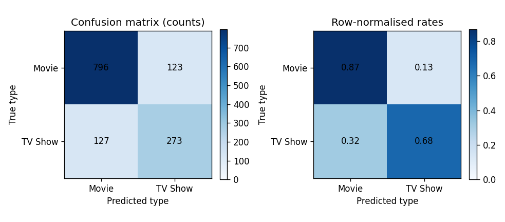
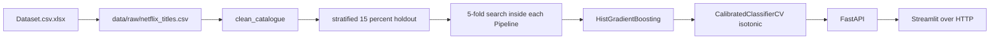

# Netflix content type prediction

A binary classifier that predicts whether a Netflix catalogue row is a **Movie** or a **TV Show** without using columns that already contain the answer. Every number below is written by a script in this repository (`scripts/profile_data.py`, `scripts/leakage_audit.py`, `scripts/train.py`, `scripts/evaluate.py`).

This build was not deployed to a public host. There is no live URL to put here. Locally, after `docker compose up --build`, the API is at `http://localhost:8000` and the UI is at `http://localhost:8501`. Hugging Face Spaces instructions are in `deploy/huggingface/README.md`. They were not executed, because this environment has no Hugging Face token.

The test confusion matrix (raw counts and row-normalised rates) is `reports/figures/confusion_matrix.png`.



## The leakage story

`duration` is a perfect label. In this file every movie is stored as minutes and every TV show as seasons (`duration_unit` logistic ROC-AUC **1.0000**, Cramér's V **0.9997**). TV-format genre names, including the plain token `TV Shows`, are the same shortcut (`genre_has_banned_tv_token` ROC-AUC **1.0000**). `has_director` is not a perfect separator, but a missing director credit already classifies **95.2%** of rows (ROC-AUC **0.8960**), so it is banned as well. The honest model is what the API serves. The leaky model is a demonstration and is not served.

| track | accuracy | balanced accuracy | F1-macro | MCC | ROC-AUC | average precision |
| --- | --- | --- | --- | --- | --- | --- |
| leaky baseline (`duration_unit`, threshold 0.5) | 1.0000 | 1.0000 | 1.0000 | 1.0000 | 1.0000 | 1.0000 |
| honest model (threshold 0.5) | 0.8120 | 0.7662 | 0.7722 | 0.5457 | 0.8846 | 0.7534 |
| honest model (tuned threshold 0.37) | 0.8105 | 0.7743 | 0.7751 | 0.5502 | 0.8846 | 0.7534 |
| no-TV-vocabulary ablation (threshold 0.5) | 0.8127 | 0.7477 | 0.7626 | 0.5353 | 0.8867 | 0.7734 |

The leaky score is worthless: it is the duration unit written back as a prediction. The honest test ROC-AUC is **0.8846**, not 0.999. Stripping a 20-word format list (`series`, `season`, `movie`, `film`, and the rest in `config.yaml`) from the title does not reduce ROC-AUC. On this extract the ablation is **0.8867**, a separate refit of the same hyperparameters, so the gap is noise rather than a format-word effect. Column permutation on the served model puts `rating` first (AUC drop **0.1837**) and `primary_country` second (**0.1536**). The whole `title` column drops AUC by **0.0193**. In the logistic model, `title__series` has a large coefficient (**2.26**) and a permutation drop of **0.0009**.

The full audit is [`reports/leakage_audit.md`](reports/leakage_audit.md). The test write-up is [`reports/evaluation.md`](reports/evaluation.md).

## Metrics

Held-out test set: **1,319** rows (15% stratified, seed 42), scored by `scripts/evaluate.py`. The served model is `hist_gradient_boosting` at threshold **0.37** on calibrated P(TV Show).

| metric | value |
| --- | --- |
| Accuracy | 0.8105 |
| Balanced accuracy | 0.7743 |
| F1-macro | 0.7751 |
| TV Show precision / recall / F1 | 0.6894 / 0.6825 / 0.6859 |
| Movie precision / recall / F1 | 0.8624 / 0.8662 / 0.8643 |
| MCC | 0.5502 |
| Cohen's kappa | 0.5502 |
| ROC-AUC | 0.8846 |
| Average precision | 0.7534 |
| Brier, uncalibrated winner | 0.1257 |
| Brier, served isotonic calibrator | 0.1257 |
| Single-row latency p50 / p95 | 27.69 ms / 58.89 ms |
| 1,000-row batch latency p50 / p95 | 101.83 ms / 116.65 ms |

Confusion counts, rows true type and columns prediction, Movie then TV Show: `[[796, 123], [127, 273]]`. That is 796 films kept as films, 123 films filed as series, 273 series kept as series, and 127 series hidden in the film list.

Training out-of-fold Brier was **0.1219** raw and **0.1223** after the fold-wise isotonic map. Calibration did not improve probability error on this model. The API still serves the isotonic probability, and the UI does not present the raw score as a probability. No threshold on the training sweep reached 95% TV-show precision, so `high_precision_threshold` is null.

Five-fold stratified CV on the 7,471 training rows (`reports/model_comparison.md`). Primary metric ROC-AUC. The stratified dummy is the floor.

| model | accuracy | F1-macro | ROC-AUC |
| --- | --- | --- | --- |
| hist_gradient_boosting | 0.8228 ± 0.0086 | 0.7790 ± 0.0122 | 0.8901 ± 0.0109 |
| logreg_plain | 0.8078 ± 0.0040 | 0.7604 ± 0.0055 | 0.8738 ± 0.0100 |
| logreg_balanced | 0.7793 ± 0.0099 | 0.7608 ± 0.0110 | 0.8733 ± 0.0102 |
| linear_svc | 0.7770 ± 0.0118 | 0.7594 ± 0.0128 | 0.8722 ± 0.0103 |
| random_forest | 0.7943 ± 0.0038 | 0.7621 ± 0.0048 | 0.8619 ± 0.0059 |
| complement_nb | 0.7658 ± 0.0081 | 0.7253 ± 0.0087 | 0.8380 ± 0.0093 |
| dummy_stratified | 0.5797 ± 0.0045 | 0.5023 ± 0.0053 | 0.5023 ± 0.0053 |

A majority-class rule would sit near the movie base rate of **0.6969** accuracy and would not rank. The stratified dummy is the one the spec asked for, and its ROC-AUC is **0.50**.

Catalogue: **8,790** rows, **6,126** movies (69.69%), **2,664** TV shows (30.31%). Source columns are the ten fields in the Excel extract. `cast` and `description` are absent.

## Architecture



Encoders, the TF-IDF vectorizer, the SVD used by the trees, the imputer, and the scaler are steps in the scikit-learn `Pipeline`. They are fit on training folds only.

## Quickstart

Python 3.11. From the repository root, with `data/raw/netflix_titles.csv` present (it is committed; regenerate it with `python scripts/export_excel.py` if you only have the Excel file):

```bash
python -m venv .venv
.venv/Scripts/python -m pip install -r requirements.txt -r requirements-dev.txt
.venv/Scripts/python scripts/profile_data.py
.venv/Scripts/python scripts/leakage_audit.py
.venv/Scripts/python scripts/train.py
.venv/Scripts/python scripts/evaluate.py
.venv/Scripts/python -m pytest --cov=src --cov-fail-under=80
.venv/Scripts/python -m uvicorn src.api.main:app --host 0.0.0.0 --port 8000
```

In a second shell:

```bash
.venv/Scripts/python -m streamlit run app/streamlit_app.py --server.port 8501
```

`make setup`, `make train`, `make test`, and `make run` call the same commands. This machine's shell is PowerShell and does not provide `make`; the CI workflow calls the tools directly.

Docker, from a clone that contains `models/`:

```bash
docker compose up --build
```

The API listens on port 8000 and the UI on port 8501. The UI reads `API_BASE_URL` and does not import the model.

On this machine `docker build` produced an image of 885 MB. `docker compose up --build` then returned `/health` 200, `/ready` ready, a `/predict` of Movie for the sample title, and UI `/_stcore/health` 200. Both containers reported healthy.

`make train` refits every candidate. The committed artifacts match the last run of `scripts/train.py` and `scripts/evaluate.py` in this tree. Training the seven models took about 49 minutes on this machine.

## Project structure

`src/data` loads and cleans. `src/features` builds the fold-safe pipeline. `src/models` searches, calibrates, and saves artifacts with `metadata.json`. `src/evaluation` scores and plots. `src/api` is the FastAPI app. `app/streamlit_app.py` is the UI. `scripts/` is the only command line. `reports/` is generated. `tests/fixtures/mini_netflix.csv` is the hand-written fixture.

## Modelling

Honest features: title TF-IDF (1–2 grams, `min_df=2`, 5,000 features, then 60-component SVD inside the tree pipelines), `primary_country`, `rating`, `release_year`, `year_added`, `month_added`, `years_to_platform`, `n_genres`, `n_countries`, `title_word_count`.

Banned: raw duration, parsed minutes, parsed seasons, the duration unit, any missingness flag on those columns, `listed_in` names, and `has_director`. Rating stayed after the quarantine (one-column ROC-AUC 0.6387). Decisions are in [`docs/DECISIONS.md`](docs/DECISIONS.md).

The winner is histogram gradient boosting (CV ROC-AUC 0.8901 ± 0.0109). Unweighted logistic regression was 0.016 AUC behind, outside the 0.005 band that would have preferred a linear model for token explanations. The API therefore returns an empty contribution list. Token coefficients in the evaluation report are a `logreg_plain` refit on the training split only.

The operating threshold **0.37** maximises F1-macro on out-of-fold calibrated P(TV Show). Confidence is the distance of that probability from 0.37: high at or above 0.20, medium at or above 0.08, otherwise low.

## API

[`docs/API.md`](docs/API.md) has a curl example and the response captured from a local server for `/health`, `/ready`, `/meta`, `/predict`, `/predict/batch`, `/predict/csv`, `/explain`, and `/metrics`. OpenAPI is at `/docs`. A body that includes `duration` returns **422**.

## Testing and CI

The local gate on 30 September 2026 was `ruff check`, `black --check`, `mypy src` (no issues in 26 files), and `pytest`: **37 passed**, coverage **86.84%** (`--cov-fail-under=80`). CI is [`.github/workflows/ci.yml`](.github/workflows/ci.yml) on push and pull request to `main`. The badge reflects that workflow after the first push:

[](https://github.com/ThevinduFernando2003/Netflix-Content-Type-Prediction/actions/workflows/ci.yml)

## Limitations and next steps

This Excel extract has no synopsis and no cast, so the model cannot read a blurb. It is English-centric, it learns this catalogue's rating and country conventions, and it has no audio or video. France (accuracy 0.500, n=26) and Canada (0.721, n=43) are the test segments more than 0.08 below the overall accuracy of 0.8105. The confident errors are mostly TV shows whose banned genre name is the real tell.

Next: train on a catalogue that actually includes synopses, keep the same bans, and put low-confidence rows in a review queue. Recalibrate if the rating mix shifts. Isotonic regression did not reduce Brier here; a later model should earn calibration rather than assume it.

Environment variables are listed in [`.env.example`](.env.example). No secrets belong in the repo.
